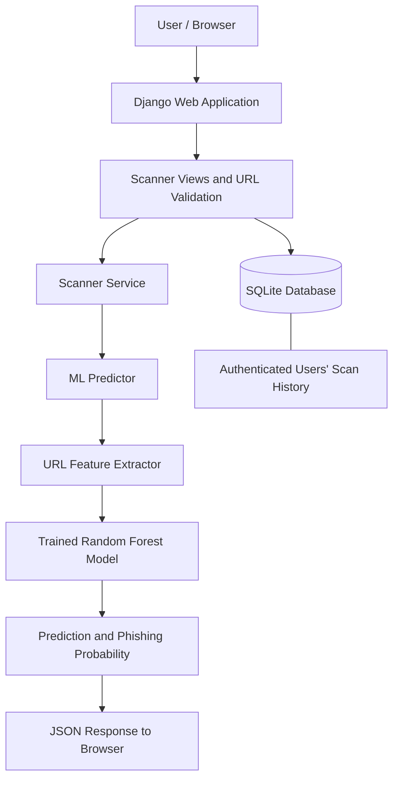

# 🛡️ PhishGuard — AI-Based Phishing URL Detection

[](https://github.com/Aleem-Ghafoor/PhishGuard/releases)


**First official release: [v1.0.0](https://github.com/Aleem-Ghafoor/PhishGuard/releases/tag/v1.0.0)**

PhishGuard is a Django-based web application that uses machine learning to classify URLs as **Legitimate** or **Phishing**. It combines URL feature extraction and a trained Random Forest model with a web interface for scanning URLs and viewing scan history.

> **Note:** A model prediction is an automated risk estimate, not a guarantee that a URL is safe or malicious. Treat suspicious links carefully even when a scan reports them as legitimate.

## ✨ Features in the current application

- User registration, login, logout, and profile functionality.
- URL scanning through the web application.
- Machine-learning-based URL classification.
- Phishing probability displayed with the prediction.
- Scan history for authenticated users.
- Separate Django applications for accounts, dashboard, and scanner.
- A standalone ML prediction interface.

This README describes the current `main` branch. Features and limitations may change in later releases.


## 🏗️ Application Architecture

The current application follows this request flow for URL scanning:



**Main components:**
- `accounts/`: user authentication and profile functionality.
- `scanner/`: scan endpoints, URL validation, prediction service, and scan history.
- `ml_engine/`: URL feature extraction and trained-model prediction.
- `dashboard/`: dashboard view and interface.
- `PhishGuard/`: Django project configuration and root routes.

## 🧠 Machine Learning

The current prediction pipeline uses a trained **Random Forest** classifier.

The ML engine is organized in `ml_engine/`:

| Component | Responsibility |
|---|---|
| `feature_extractor.py` | Extracts numerical features from a URL |
| `predictor.py` | Loads the trained model and predicts a URL class |
| `train.py` | Model training workflow |
| `evaluation.py` | Model evaluation utilities |
| `model/` | Trained model artifact |

The prediction interface can be called from Python:

```python
from ml_engine.predictor import predict_url

result = predict_url("https://example.com")
print(result)
```

The result includes the predicted class, phishing probability, and configured classification threshold.

## 📊 Dataset

The data engineering documentation for this project describes the **Phishing Site URLs** dataset, contributed by `taruntiwarihp`, with the original file `phishing_site_urls.csv`.

The documented data preparation process includes:
- Cleaning missing, empty, duplicate, and conflicting URL records.
- Exploratory data analysis.
- Extracting six numerical URL features.
- Encoding labels as `good = 0` and `bad = 1`.
- Creating an 80:20 stratified train-test split.

For the detailed dataset statistics, feature definitions, and preprocessing workflow, see **[DATASET_DOCUMENTATION.md](DATASET_DOCUMENTATION.md)**.

Dataset files are not included in the repository. The trained model is stored using **Git LFS**.

## 🛠️ Technology Stack

| Technology | Purpose |
|---|---|
| Python | Main programming language |
| Django | Web application and backend |
| Scikit-learn | Machine learning |
| Pandas and NumPy | Data processing |
| Joblib | Model serialization |
| XGBoost | Model experimentation |
| HTML, CSS, JavaScript | Frontend |
| SQLite | Current development database configuration |
| Git and GitHub | Version control and collaboration |
| Git LFS | Large model artifact storage |

## 📁 Project Structure

```text
PhishGuard/
├── PhishGuard/       # Django project configuration and root views
├── accounts/         # User authentication and profile functionality
├── dashboard/        # Dashboard application
├── scanner/          # URL scanning, prediction service, and scan history
├── ml_engine/        # Feature extraction, training, prediction, and model
├── datasets/         # Local dataset and processed data
├── docs/             # Project documentation
├── static/           # CSS, JavaScript, and static assets
├── templates/        # Django HTML templates
├── manage.py
├── requirements.txt
├── DATASET_DOCUMENTATION.md
└── README.md
```

Dataset files are maintained locally and excluded from Git tracking. The trained model is managed through Git LFS.

## 🚀 Setup and Run Locally

### 1. Clone the repository

```bash
git clone https://github.com/Aleem-Ghafoor/PhishGuard.git
cd PhishGuard
```

### 2. Install and pull Git LFS files

Git LFS is required to retrieve the trained model artifact.

```bash
git lfs install
git lfs pull
```

### 3. Create and activate a virtual environment

**Windows (PowerShell):**

```powershell
python -m venv venv
.\venv\Scripts\Activate.ps1
```

**Windows (Command Prompt):**

```bat
python -m venv venv
venv\Scripts\activate
```

**Linux / macOS:**

```bash
python3 -m venv venv
source venv/bin/activate
```

### 4. Install dependencies

```bash
python -m pip install --upgrade pip
pip install -r requirements.txt
```

### 5. Configure your Django secret key

The `SECRET_KEY` is intentionally not stored in GitHub. Each developer must generate their own local secret key before running the application.

1. Generate a new Django secret key:

   ```bash
   python -c "from django.core.management.utils import get_random_secret_key; print(get_random_secret_key())"
   ```

2. In the project root (the same folder as `manage.py`), create a file named `.env`.
3. Copy the generated key into `.env` in this format:

   ```env
   SECRET_KEY=paste-your-generated-key-here
   ```

   Replace the placeholder with the key printed by the command. Do not add quotes unless needed, and do not share or commit this file.

4. Make sure `.env` is excluded by `.gitignore`. Never push your real secret key to GitHub.

Generate a separate key for each developer's local environment. You do not need the repository owner's secret key to run the project.

### 6. Apply database migrations

```bash
python manage.py migrate
```

### 7. Start the development server

```bash
python manage.py runserver
```

Open **http://127.0.0.1:8000/** in your browser.

The repository currently uses SQLite and Django's development server configuration. This setup guide is for local development; production deployment configuration is outside the scope of this first release.

## 👥 Team Collaboration

The project is developed collaboratively using Git and GitHub. Work is organized in feature branches and integrated through pull requests.

| Work area | Responsibilities |
|---|---|
| Data engineering | Dataset cleaning, preprocessing, EDA, and feature preparation |
| Machine learning | Model training, evaluation, comparison, and prediction |
| Django application | Backend, authentication, scanning, history, and application integration |

## 📦 Release Status

**Current release: [PhishGuard v1.0.0 — First Official Release](https://github.com/Aleem-Ghafoor/PhishGuard/releases/tag/v1.0.0)**

This release represents the implementation captured on the `main` branch at the `v1.0.0` tag.

Further code-quality improvements, comprehensive application testing, and additional hardening are planned for a subsequent release. The first release should not be interpreted as a claim that the application has completed production-readiness or comprehensive security testing.

## 📄 Project Documentation

- [Dataset documentation](DATASET_DOCUMENTATION.md)
- [GitHub repository](https://github.com/Aleem-Ghafoor/PhishGuard)
- [v1.0.0 release notes](https://github.com/Aleem-Ghafoor/PhishGuard/releases/tag/v1.0.0)

## 📜 License

This project is developed for educational and academic purposes.


## Scanner hardening (PR #27)

The scanner endpoint is public and protected by a per-client-IP limit of 10 POST requests per 60-second window. Invalid URL syntax and port values are rejected before inference. Unexpected inference failures are logged server-side while the API returns a generic error to the client. The development configuration uses Django's local-memory cache; multi-worker or multi-instance deployments must use a shared cache backend such as Redis. See [Scanner hardening notes](docs/scanner-hardening.md).
