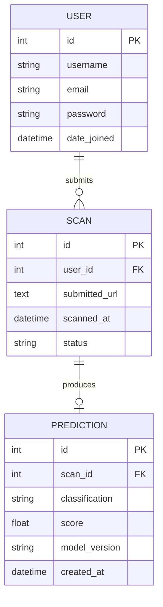

# PhishGuard — Database ER Diagram

## MVP Entities

The initial database uses Django's built-in User model plus two application models: `Scan` and `Prediction`.

## ER Diagram

## Entity Definitions

### User
Use Django's built-in `django.contrib.auth.models.User` initially. Do not create a duplicate custom user model unless a specific requirement justifies it.

### Scan
Suggested fields:
- `id`: primary key.
- `user`: nullable foreign key to User; null for guest scans.
- `submitted_url`: submitted URL string.
- `scanned_at`: timestamp.
- `status`: status such as `pending`, `completed`, or `failed`.

### Prediction
Suggested fields:
- `id`: primary key.
- `scan`: one-to-one relationship to Scan.
- `classification`: supported class, such as `phishing` or `legitimate`.
- `score`: model score with documented meaning and range.
- `model_version`: identifier for the model used.
- `created_at`: timestamp.

## Relationships and Cardinality

| Relationship | Cardinality | Explanation |
|---|---|---|
| User to Scan | One-to-many | One registered user can have many scans; guest scans have no user reference |
| Scan to Prediction | One-to-zero-or-one | A scan may fail before prediction, or produce one prediction |

## Data Rules
- A scan has a unique primary key.
- Guest scans may have a null user reference.
- Registered users may access only their own scans.
- A failed scan may have no Prediction record.
- Store a score only when a prediction is successfully generated.
- Define whether the score is a probability, confidence estimate, or another model output before displaying it to users.
