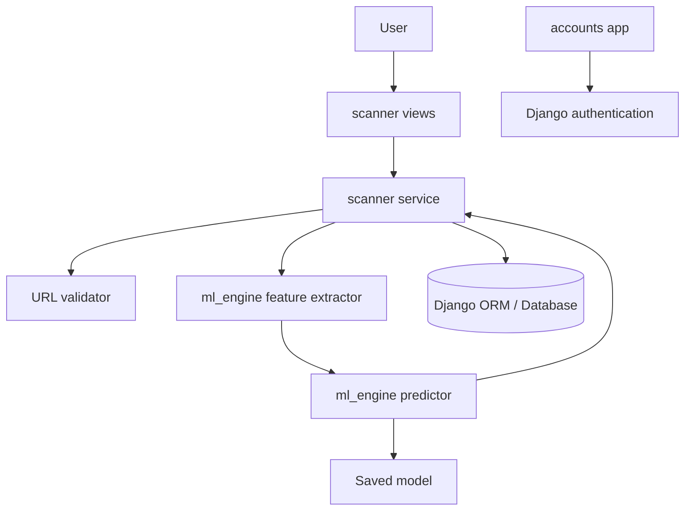

# PhishGuard — Django App Responsibilities

## Proposed Project Structure

```text
PhishGuard/
├── PhishGuard/                 # Django project configuration package
│   ├── __init__.py
│   ├── settings.py
│   ├── urls.py
│   ├── asgi.py
│   └── wsgi.py
├── accounts/                   # Authentication and account workflows
│   ├── migrations/
│   ├── templates/
│   ├── forms.py
│   ├── urls.py
│   ├── views.py
│   └── tests.py
├── scanner/                    # URL scanning and scan history
│   ├── migrations/
│   ├── models.py
│   ├── services.py
│   ├── validators.py
│   ├── urls.py
│   ├── views.py
│   └── tests.py
├── ml_engine/                  # Python package for ML inference
│   ├── __init__.py
│   ├── feature_extractor.py
│   ├── predictor.py
│   └── model/
├── templates/
├── static/
├── docs/
├── manage.py
├── requirements.txt
└── .gitignore
```

## Module Responsibilities

| Module | Responsibility |
|---|---|
| `PhishGuard/` | Django settings, root URLs, ASGI, and WSGI configuration |
| `accounts/` | Registration, login, logout, and account-related forms/views |
| `scanner/` | URL submission, scan workflow, scan/prediction models, and scan history |
| `ml_engine/` | URL feature extraction and ML inference, independent of HTTP request handling |
| `templates/` | HTML templates |
| `static/` | CSS, JavaScript, and static images |
| `docs/` | Requirements and design documentation |

## Module Communication



## Engineering Rules
- Keep ML code separate from Django views.
- Keep orchestration and business logic in service functions.
- Use Django ORM for database access.
- Enforce ownership checks when retrieving scan history.
- Add tests for validation, feature extraction, prediction, and scan workflows.
- Do not commit virtual environments, secrets, local databases, or generated model files unless the repository's model-artifact policy explicitly requires them.
- Keep model artifacts and feature definitions versioned together so inference remains compatible with training.


## 7. Scanner hardening modules (PR #27)

- `scanner/rate_limit.py`: per-client-IP scan throttling (10 requests per 60 seconds).
- `scanner/validation.py`: validates URL input, HTTP/HTTPS scheme, hostname, and port syntax/range.
- `scanner/views.py`: applies rate limiting to the public scan API and logs unexpected scan failures while returning a generic error response.
- `scanner/tests.py`: contains validation, scan API, rate-limit, and error-logging tests. PR #27 notes that these tests still need to be executed locally.

The rate limiter uses Django's configured cache. The local-memory backend is not a shared counter across multiple application workers or instances.
