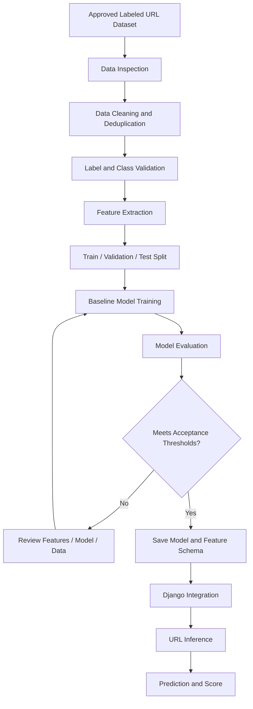

# PhishGuard — Machine Learning Pipeline

## Objective

Train and evaluate a classifier that predicts whether a URL is phishing-related or legitimate using URL-derived features.

## Pipeline

## Pipeline Stages

| Stage | Responsibility |
|---|---|
| Dataset inspection | Review source, labels, class balance, and data quality |
| Cleaning | Handle duplicates, missing values, and malformed records |
| Label validation | Confirm consistent phishing and legitimate labels |
| Feature extraction | Derive URL characteristics using a documented schema |
| Data splitting | Separate training, validation, and test data without leakage |
| Model training | Train baseline and candidate classifiers |
| Evaluation | Measure precision, recall, F1-score, confusion matrix, and other suitable metrics |
| Model persistence | Save the trained model and feature schema |
| Integration | Load the same preprocessing and model pipeline in Django |

## Evaluation Requirements
- Use a held-out test set for final evaluation.
- Check for duplicate URLs across data splits to reduce leakage.
- Report class balance and per-class precision, recall, and F1-score.
- Consider false negatives especially important because phishing URLs predicted as legitimate can expose users to risk.
- Choose the model based on documented evaluation criteria, not accuracy alone.

## Inference Contract
The inference module must:
1. Accept a URL string.
2. Validate and normalize it consistently with training.
3. Extract features in the exact expected order.
4. Return a supported class and a clearly defined score.
5. Handle unsupported input and model errors without inventing a prediction.

## Security Note
The MVP analyzes the URL string only. It must not automatically visit, execute, or fetch the submitted URL.
