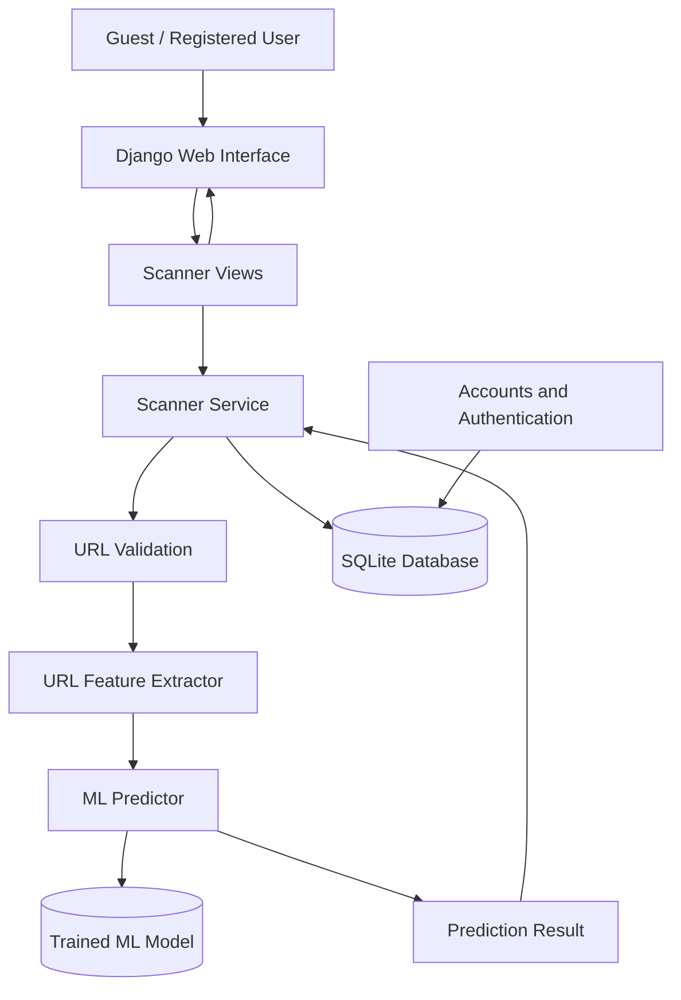

# PhishGuard — System Architecture

## Overview

PhishGuard uses a Django web application with a separate ML inference module. The initial scanner processes URL strings and extracted URL features; it does not automatically visit submitted URLs.

## High-Level Architecture

## Component Responsibilities

| Component | Responsibility |
|---|---|
| Django web interface | Accept user input and display results |
| Scanner views | Handle HTTP requests and responses |
| Scanner service | Coordinate validation, feature extraction, prediction, and persistence |
| URL validation | Check input format and allowed URL schemes |
| Feature extractor | Convert URL strings into the model's expected feature representation |
| ML predictor | Load the model and return the prediction and score |
| Trained model | Perform phishing/legitimate classification |
| Accounts | Registration, login, logout, and authentication |
| Database | Store users, scans, and predictions |

## Request Flow
1. The user submits a URL through the web interface.
2. Django validates the request and delegates to the scanner service.
3. The service validates the URL.
4. The feature extractor produces features in the exact order and format used during training.
5. The predictor invokes the trained model.
6. The service stores the scan and prediction when successful.
7. Django returns the result to the user.

## Engineering Constraints
- Keep ML logic outside Django views.
- Keep the feature schema consistent between training and inference.
- Do not fetch or execute user-submitted URLs in the MVP.
- Enforce scan ownership in database queries and views.
- Do not treat model confidence as a guarantee of safety.

## 8. Scanner request protection (PR #27)

The public scan API is decorated with a per-client-IP rate limiter. The configured policy allows 10 requests in a 60-second window and returns HTTP 429 when exceeded. The limiter stores counters through Django's cache framework. The current local-memory cache is intended for development/single-process use; production deployments with multiple workers or instances need a shared cache such as Redis. URL validation occurs before inference. Unexpected scan exceptions are logged through the scanner view logger and a generic JSON error is returned to the client.
