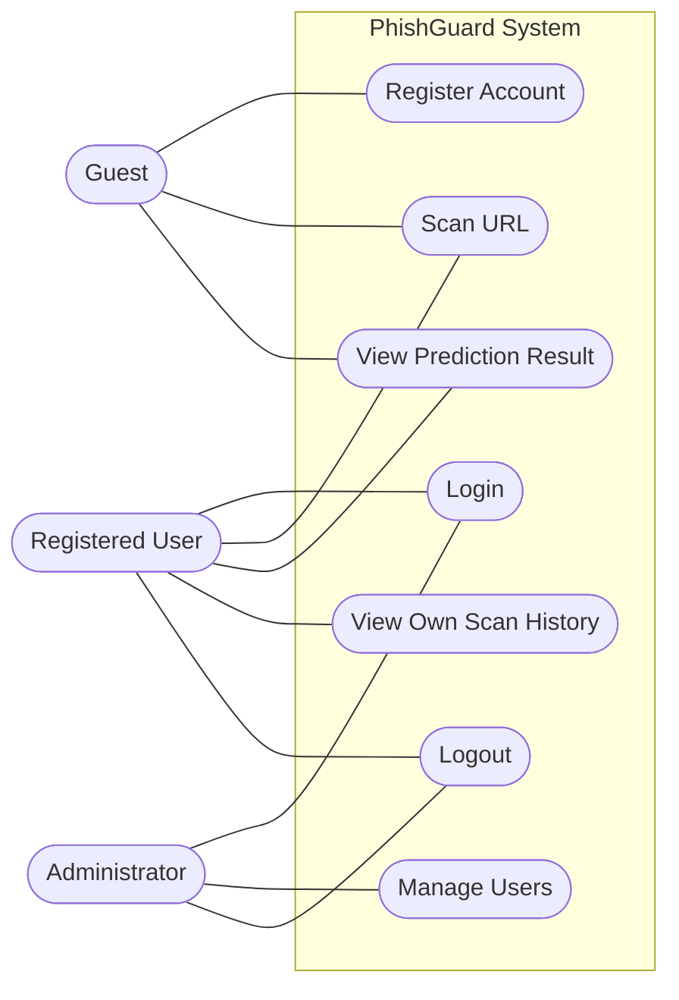

# PhishGuard — Use Case Diagram

## Actors
- **Guest:** Can submit a URL and view its result without creating an account.
- **Registered User:** Can scan URLs, view results, and view their own scan history.
- **Administrator:** Can authenticate and manage user accounts.

## Diagram

## Use Case Summary

| Use case | Actor | Description |
|---|---|---|
| Register account | Guest | Create an account |
| Login | Registered user / Admin | Authenticate |
| Scan URL | Guest / Registered user | Submit a URL for analysis |
| View prediction result | Guest / Registered user | View classification and score |
| View own scan history | Registered user | View their own previous scans |
| Logout | Registered user / Admin | End the session |
| Manage users | Admin | Manage user accounts |

## Notes
- Guest scans do not require an account.
- Scan history is available only to authenticated users and must be scoped to the current user.
- The diagram is a high-level MVP view; detailed use-case specifications are in `SRS.md`.

## 6. Scanner abuse-control behaviour (PR #27)

The guest and registered-user scan use cases remain available without mandatory login. The public scan endpoint applies a per-client-IP limit of 10 POST requests per 60 seconds. Requests over the limit receive HTTP 429. Invalid URL input is rejected before model inference. Unexpected internal failures are logged server-side and returned as a generic client error. These controls do not change the actor permissions for scan history.
